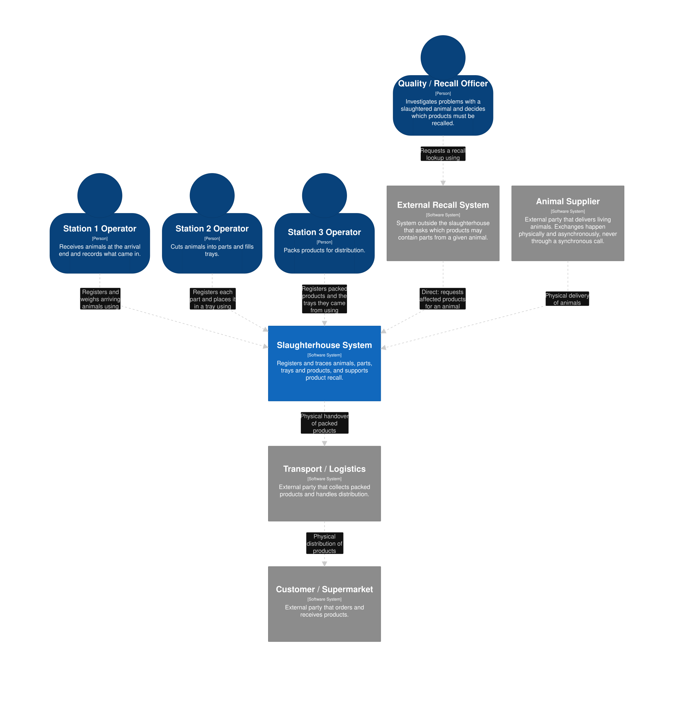
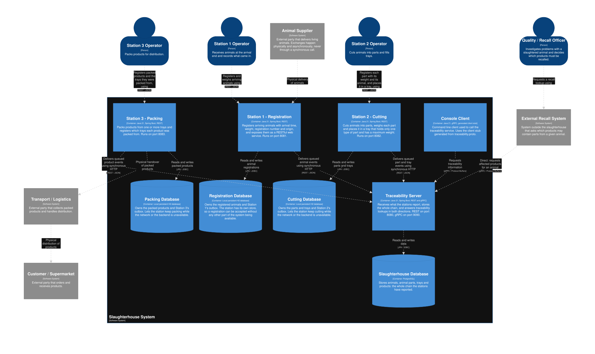
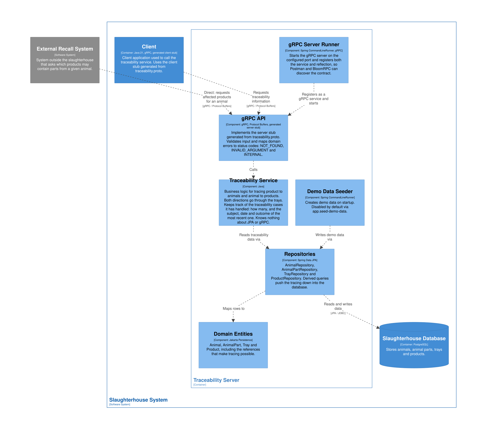
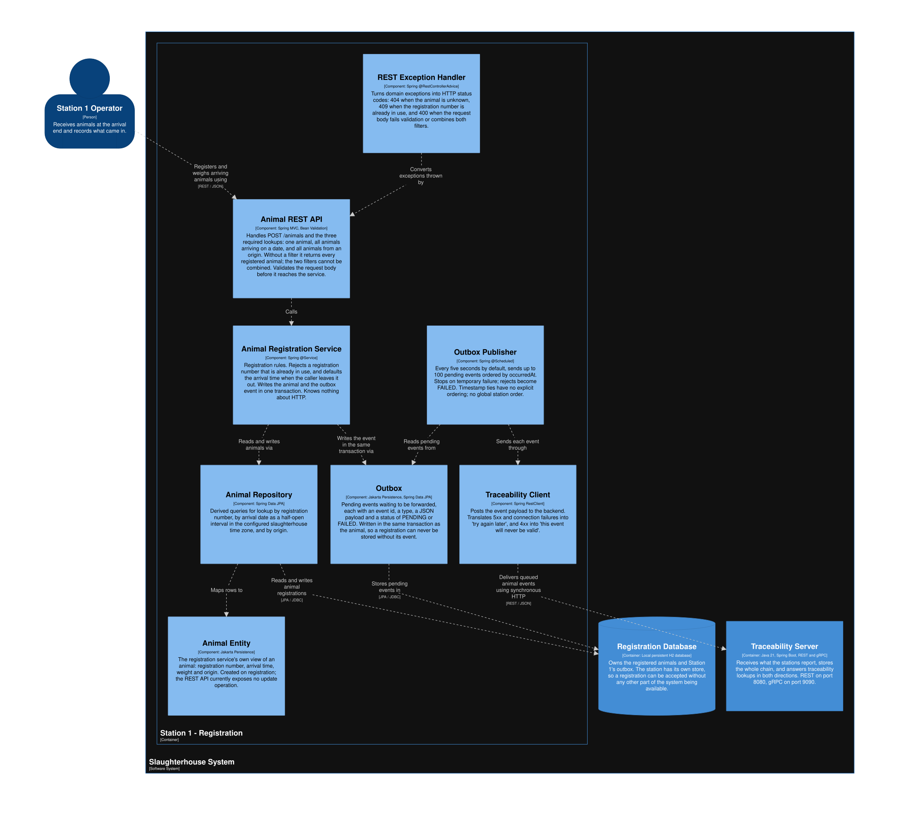

# DSY Course Assignment - SlaughterHouse
2026-09-20

## Projektets formål
Dette er et studieprojekt og projektet har dermed ikke til formål at bygge et produktionsklart slagterisystem, men at give den studerende (mig) praktisk erfaring med distribuerede systemer, som er et nyt fagområde dette semester.

Repository indeholder en simulering af et slagteri og er en del af kurset **'DSY - Distribuerede Systemer'**. Casen er et slagteri hvor levende dyr ankommer i den ene ende, og færdigpakkede produkter leveres i den anden ende. Undervejs passerer dyret tre stationer: registrering, opskæring i dele, og pakning af produkter.

Det centrale krav er **sporbarhed / tracking**. Hvis det senere viser sig at der er problemer med et slagtet dyr, skal alle produkter der kan indeholde dele fra dyret, kunne kaldes tilbage. Den funktion skal kunne tilgås udefra, og derfor er den eksponeret som en gRPC-service.

## Domænemodel
Domænemodellen viser de centrale begreber i slagteriet og relationerne mellem dem.


Sporingskæden er en vigtig del af modellen:

- Et `Animal` bliver skåret op i flere `AnimalPart`, og hver del husker hvilket dyr den kom fra.
- Hver `AnimalPart` lægges i en `Tray`. En bakke indeholder kun én type dele og har en maksimal vægtkapacitet.
- Et `Product` pakkes ud fra en eller flere `Tray`, og gemmer referencer tilbage til de bakker delene kom fra.

Et produkt peger på bakker, ikke på enkelte dele. Det matcher virkeligheden: når man pakker fra en bakke, ved man hvilke dyr der kan være i bakken, men ikke nødvendigvis hvilken del der er endt i hvilken pakke. Sporingen bliver derfor en bevidst overvurdering — den finder alle dyr der **kan** være i produktet.

## Arkitektur (C4-modellen)
Arkitekturen er modelleret i **Structurizr** med C4-modellens tre første niveauer. Kilden er én tekstfil, `docs/architecture/workspace.dsl`, som alle diagrammerne genereres ud fra.

Diagrammerne er store. Klik på et diagram for at åbne det i fuld størrelse.

### C1 - System Context
Hvad bygger vi, hvem bruger det, hvad gør brugerne, og hvordan passer systemet ind i det eksisterende systemlandskab. Fokus er på **typerne af kommunikation** frem for på teknologi.

<a href="docs/diagrams/C1-SystemContext.svg" target="_blank" rel="noopener">
  
</a>

De blå figurer er systemets faktiske **brugere**: de tre stationsoperatører og en quality officer. De grå kasser er **eksterne systemer og parter** omkring systemet — de bruger ikke softwaren, men afgrænser processen.

- **Animal Supplier**, **Transport / Logistics** og **Customer / Supermarket** kommunikerer **indirekte**. De udveksler fysiske varer, og systemet må ikke gå i stå fordi en af dem er utilgængelig.
- **External Recall System** kommunikerer **direkte** over gRPC. Det er her sporbarhedsopslaget kaldes, og det er den del der er implementeret i dette projekt.

### C2 - Container View
Hvordan systemet er delt op i kørende enheder, og hvordan de taler sammen.

<a href="docs/diagrams/C2-Container.svg" target="_blank" rel="noopener">
  
</a>

Det stiplede er **planlagt**, ikke bygget. Station 1, dens database, traceability-serveren og dens PostgreSQL er implementeret. Station 2 og Station 3 er stadig planlagte.

Hver station har sin egen lokale database. Det er den del der opfylder casens krav om at *"work shouldn't stop at a station just because the network is down"* — en station kan registrere videre uden at være afhængig af resten af systemet. Selve synkroniseringen op til traceability-databasen er modelleret som indirekte kommunikation, men ligger uden for opgavens rammer og er derfor ikke implementeret.

### C3 - Component View: Traceability Server
Serveren zoomet ind. Diagrammet afspejler den faktiske kode i `server`-modulet.

<a href="docs/diagrams/C3-Component-Traceability.svg" target="_blank" rel="noopener">
  
</a>

Kontrakten bor i `traceability.proto`, og gRPC genererer en **client stub** og en **server stub** ud fra den. `gRPC API` implementerer server-stubben og oversætter domænefejl til statuskoder, mens `Traceability Service` holder sporingslogikken fri for både JPA og gRPC.

### C3 - Component View: Station 1 (Registration)
Registration-servicen zoomet ind. Afspejler koden i `registration-service`-modulet.

<a href="docs/diagrams/C3-Component-Registration.svg" target="_blank" rel="noopener">
  
</a>

`Animal REST API` validerer input og holder HTTP ude af resten, `Animal Registration Service` har registreringsreglerne, og `REST Exception Handler` oversætter domænefejl til 404, 409 og 400.

## Lokal infrastruktur

De to services har hver sin database: traceability bruger PostgreSQL, Station 1 bruger sin egen H2-fil under `DSY-SlaughterHouse/data/`. H2 er indlejret og kræver ingen opsætning.

Serverens egen `application.properties` er ikke i versionsstyring, fordi den indeholder databasekodeordet. Kopiér `server/src/main/resources/application.properties.example` til `application.properties` og udfyld `DB_PASSWORD` første gang.

PostgreSQL kører som en lokal installation på maskinen. Vil du i stedet køre den i Docker, skal den lokale tjeneste stoppes først, og `.env` oprettes ud fra `.env.example`:

```powershell
docker compose up -d
```

## Sådan afprøver du systemet

### Traceability over gRPC

Sæt `app.seed-demo-data=true` i `server/src/main/resources/application.properties` første gang. Seederen opretter tre dyr (`1`, `2`, `3`), tre bakker, fire dele og to produkter: `PROD-LOIN-PACK` og `PROD-HALF-ANIMAL`.

Den kører **kun hvis `animal`-tabellen er tom**. Har databasen data fra tidligere, springer den over, og id'erne nedenfor findes ikke. Tjek hvad der faktisk ligger i den:

```powershell
psql -h localhost -U postgres -d slaughterhouse -c "select product_id from product" -c "select animal_id from animal"
```

Start `Server` fra IDE'en og kør konsolklienten med et produkt-id og et dyre-id:

```powershell
mvn -pl client exec:java "-Dexec.mainClass=com.example.Client" "-Dexec.args=PROD-LOIN-PACK 1"
```

Med demodata svarer den `Animals in product PROD-LOIN-PACK: [1, 2]` og `Products from animal 1: [PROD-HALF-ANIMAL, PROD-LOIN-PACK]` — begge sporingsretninger på én gang.

Et ukendt id giver `NOT_FOUND`. Et kendt dyr der endnu ikke er pakket giver `OK` med en tom liste. Servicen kan også kaldes fra Postman eller BloomRPC — gRPC reflection er slået til, så kontrakten kan hentes automatisk.

### Registrering over REST

Start `RegistrationServiceApplication` fra IDE'en.

```powershell
Invoke-RestMethod -Uri http://localhost:8081/animals -Method Post -ContentType "application/json" -Body '{"registrationNumber":9001,"weight":97.5,"origin":"Noerregaard"}'
```

Svaret er `201 Created` med en `Location`-header. Udelades `arrivalDateTime`, sætter servicen den til nu, så datoopslaget nedenfor skal bruge dagens dato:

```powershell
Invoke-RestMethod -Uri http://localhost:8081/animals/9001
Invoke-RestMethod -Uri "http://localhost:8081/animals?date=2026-10-20"
Invoke-RestMethod -Uri "http://localhost:8081/animals?origin=Noerregaard"
```

Samme registreringsnummer to gange giver `409 Conflict`, et ukendt nummer giver `404 Not Found`, og en ugyldig body giver `400 Bad Request`.

## Oversigt over systemets struktur
```
DSY-SlaughterHouse/
├── pom.xml                 parent, styrer versioner for alle moduler
├── compose.yaml            PostgreSQL
├── proto/                  gRPC-kontrakten
├── server/                 Traceability: gRPC, PostgreSQL
├── registration-service/   Station 1: REST, egen H2-database
├── client/                 konsolklient til gRPC
└── docs/
    ├── architecture/       Structurizr workspace
    └── diagrams/           eksporterede diagrammer
```

`proto` indeholder kun gRPC-kontrakten. `server` og `registration-service` er to selvstændige Spring Boot-applikationer med hver sin database, og de afhænger hverken af hinanden eller af de samme moduler.

## gRPC-API
Kontrakten er defineret i `proto/src/main/proto/traceability.proto`:

```protobuf
service TraceabilityService {
  rpc GetAnimalsForProduct(GetAnimalsForProductRequest)
      returns (GetAnimalsForProductResponse);

  rpc GetProductsForAnimal(GetProductsForAnimalRequest)
      returns (GetProductsForAnimalResponse);
}
```

Fejl oversættes til gRPC-statuskoder i stedet for at boble op som tekniske exceptions:

| Situation | Statuskode |
| --- | --- |
| Opslaget lykkedes | `OK` |
| Ukendt `productId` eller `animalId` | `NOT_FOUND` |
| Tomt `productId`, eller `animalId` der ikke er positivt | `INVALID_ARGUMENT` |
| Uventet fejl, f.eks. databasen er nede | `INTERNAL` |

Et dyr der findes, men endnu ikke er pakket, er ikke en fejl. Det giver `OK` med en tom liste.

## REST-API

Registreringsservicen ligger på `http://localhost:8081`.

| Metode og sti | Betydning | Svar |
| --- | --- | --- |
| `POST /animals` | Registrér et dyr | `201` med `Location` |
| `GET /animals/{registrationNumber}` | Ét bestemt dyr | `200` eller `404` |
| `GET /animals?date=2026-10-20` | Alle dyr ankommet den dato | `200` |
| `GET /animals?origin=Noerregaard` | Alle dyr fra den gård | `200` |
| `GET /animals` | Alle dyr | `200` |

De to filtre kan ikke kombineres — `?date=…&origin=…` svarer `400` i stedet for at ignorere det ene i stilhed.

Fejl følger samme princip som på gRPC-siden — domænefejl bliver til statuskoder, ikke stacktraces:

| Situation | Statuskode |
| --- | --- |
| Ukendt registreringsnummer | `404 Not Found` |
| Registreringsnummer allerede i brug | `409 Conflict` |
| Manglende eller ugyldigt felt i body | `400 Bad Request` |
| `date` og `origin` i samme kald | `400 Bad Request` |

Datoopslaget bruger et halvåbent interval `[dagen 00:00, dagen efter 00:00)`, så et dyr der ankom 23:59 tæller med på sin egen dag. Opslag på gård er ikke versalfølsomt.

## Persistens

De to services deler hverken database eller skema. Traceability ejer `animal`, `animal_part`, `tray` og `product` i PostgreSQL; registration ejer `registered_animal` i sin egen H2-fil. De kan startes, stoppes og udvikles uafhængigt af hinanden.

Opslagene bruger afledte queries, fx `findByTrayIn(...)` og `findByOriginIgnoreCase(...)`, så filtreringen sker i databasen frem for i hukommelsen.

## Test

Projektet har 45 tests, delt op efter lag: forretningslogikken isoleret med mocks, servicerne mod en database i hukommelsen, og yderlagene hver for sig — gRPC in-process og REST med MockMvc. Begge applikationer har desuden en `contextLoads`-test, der beviser at de overhovedet starter.

Testene er kommenteret på dansk, da de også fungerer som mine egne noter til hvad der testes og hvorfor.

## Teknologier

- Java 21
- Maven multi-modul projekt
- gRPC og Protocol Buffers
- Spring Boot og Spring Data JPA
- PostgreSQL og H2
- JUnit 5, Mockito og AssertJ
- Astah til domænemodel
- Structurizr (DSL) til C4-diagrammerne

## Status
Implementeret:

- Domænemodel
- C1, C2 og C3 modelleret i Structurizr
- gRPC-service med begge sporingsopslag
- Persistens i PostgreSQL via Spring Data JPA
- Eksplicit fejlhåndtering med gRPC-statuskoder
- 45 tests fordelt på lagene
- Konsolklient til afprøvning
- gRPC reflection, så servicen kan testes med Postman og BloomRPC
- Demodata-seeder, der kan slås til og fra
- Station 1 som selvstændig REST-service med egen database
- Eksplicit fejlhåndtering med HTTP-statuskoder: 201, 400, 404 og 409

Ikke implementeret endnu:

- Station 2 og Station 3 som kørende enheder
- Synkronisering af stationernes lokale data op til traceability-databasen
- Håndhævelse af bakkernes maksimale vægtkapacitet
- Autentificering og autorisation
