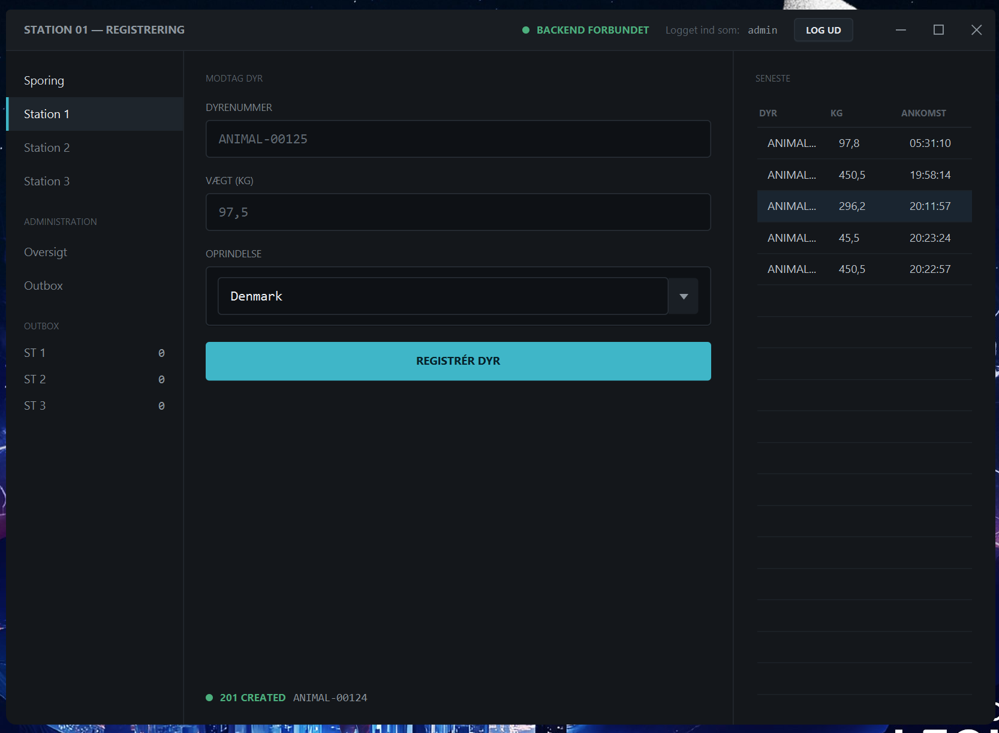
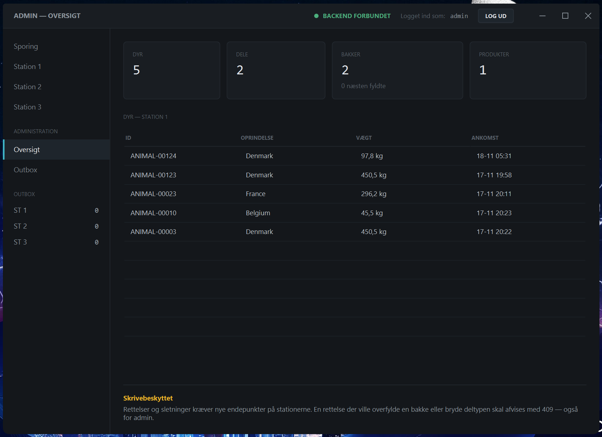
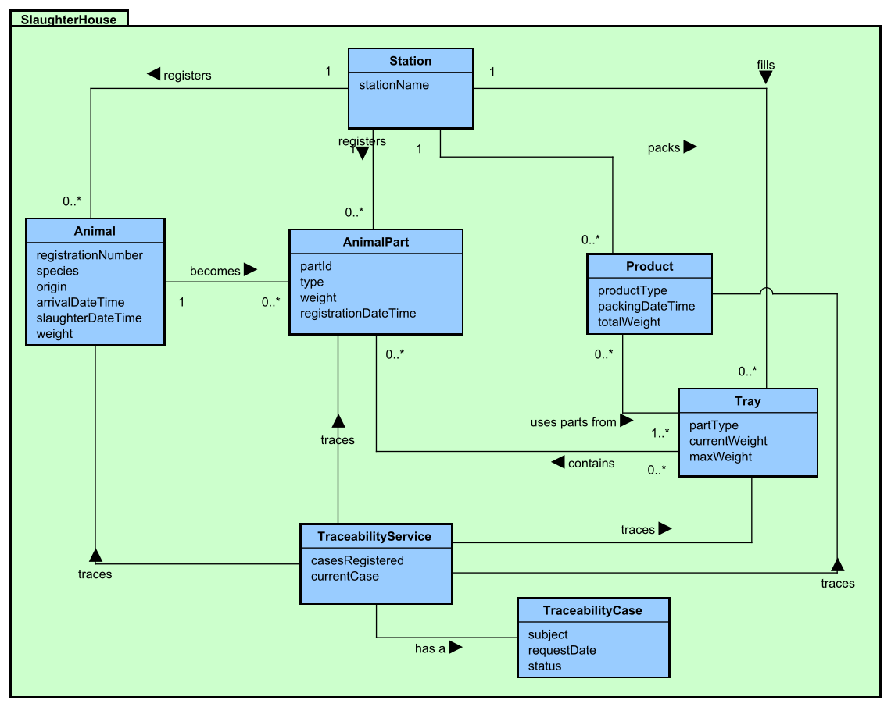
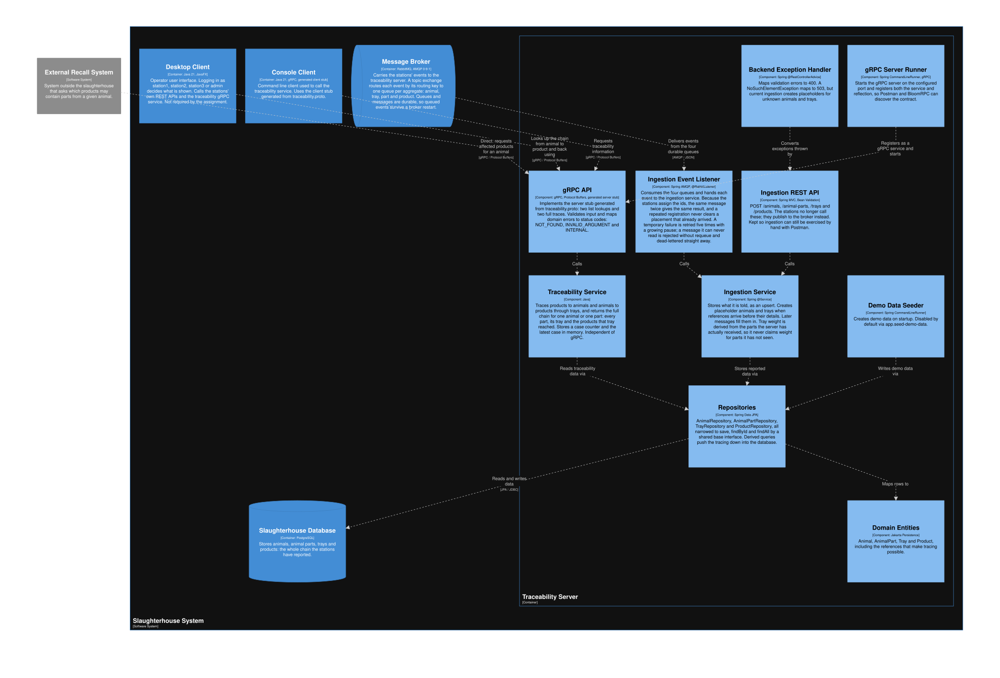
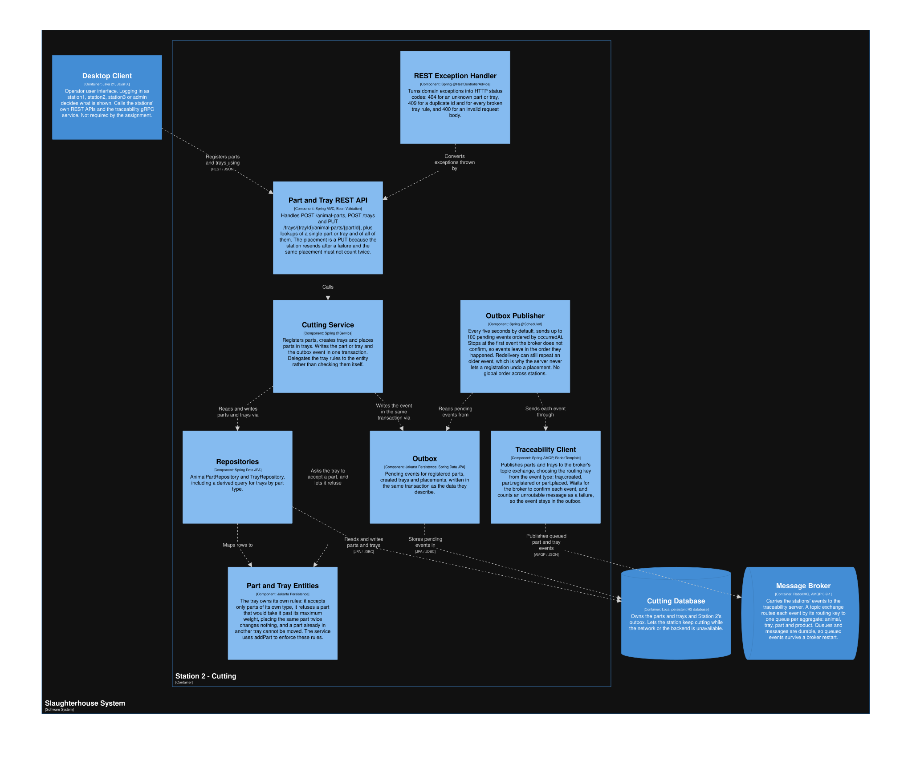
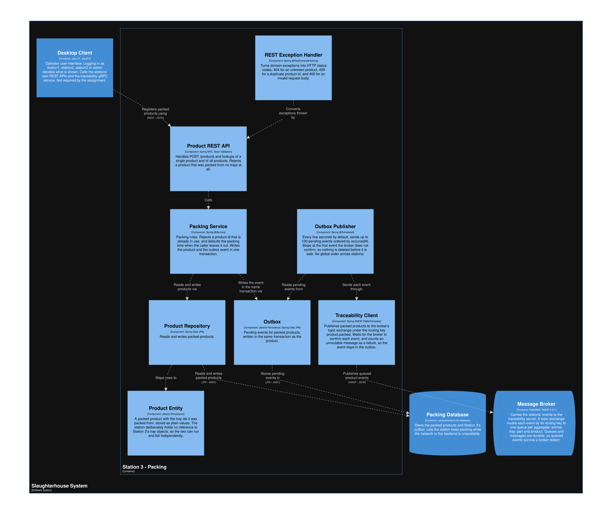

# DSY-SlaughterHouse

Studieprojekt i **DSY – Distribuerede Systemer**: tre stationer registrerer dyr, udskæringer og produkter. En JavaFX-desktopklient betjener stationerne, mens gRPC giver sporbarhed fra produkt til dyr og tilbage.

Stationerne gemmer lokalt i hver sin database og synkroniserer via outbox, så registreringerne kan fortsætte, når forbindelsen til serveren er nede.

Klik på billederne for at åbne dem i fuld størrelse.

<table>
  <tr>
    <th>Login</th><th>Station 1</th><th>Station 2</th><th>Station 3</th><th>Oversigt</th>
  </tr>
  <tr>
    <td><a href="docs/frontend/GUI/LogIn.png"></a></td>
    <td><a href="docs/frontend/GUI/Station1.png"></a></td>
    <td><a href="docs/frontend/GUI/Station2.png"></a></td>
    <td><a href="docs/frontend/GUI/Station3.png"></a></td>
    <td><a href="docs/frontend/GUI/Oversigt.png"></a></td>
  </tr>
</table>

<details>
<summary><strong>Implementerede funktioner</strong></summary>

- **Login:** lokale demobrugere med stationsroller og administratorrolle. Stationsbrugere får adgang til egen station og sporing; admin kan tilgå alle stationer, oversigt og outbox.
- **Station 1:** registrering af vægt og oprindelse, forslag fra tidligere oprindelser samt liste over seneste dyr. GUI’en vælger næste registreringsnummer; serveren sætter ankomsttidspunktet.
- **Station 2:** registrering af dele med type, vægt og kildedyr, oprettelse af bakker og valgfri placering i en bakke. Kapacitetsbjælker viser fyldningsgraden.
- **Bakkeregler:** én deltype, maksimal vægt og ingen flytning af en allerede placeret del. Gentagen placering i samme bakke tæller ikke dobbelt.
- **Station 3:** valg af produkttype og kildebakker, filtrering af bakker og forslag til samlet vægt, som kan justeres før pakning.
- **ID’er:** GUI’en foreslår også næste del-, bakke- og produkt-id ud fra eksisterende data.
- **Sporing:** søg på produkt, dyr eller del. Dyr og dele vises med sporingskæden i en trævisning; produktopslag viser mulige kildedyr.
- **Adminoversigt:** antal dyr, dele, bakker og produkter samt liste over registrerede dyr.
- **Driftsstatus:** forbindelsesstatus og køtal kontrolleres hvert femte sekund. Admin kan filtrere outbox på ventende/fejlede hændelser og se deres payload.

</details>

<details>
<summary><strong>Kom i gang og demologin</strong></summary>

Kræver **Java 21, Maven, PostgreSQL og RabbitMQ**.

1. Opret databasen `slaughterhouse`, eller opret `.env` ud fra `.env.example` og kør `docker compose up -d`.
2. Kopiér `server/src/main/resources/application.properties.example` til `application.properties`. Angiv `DB_PASSWORD` som miljøvariabel; tilpas eventuelt `DB_URL` og `DB_USERNAME`.
3. Start RabbitMQ. Uden brokeren tager stationerne stadig imod data, men hændelserne bliver liggende i deres outbox og når aldrig frem til sporbarheden.

   ```powershell
   & "C:\rabbitmq\sbin\rabbitmq-server.bat"
   ```

   Serveren opretter selv exchange, køer og bindings ved opstart. Management-UI’et ligger på `http://localhost:15672` med `guest` / `guest`.

4. Byg fra projektets rodmappe:

   ```powershell
   mvn install -DskipTests
   ```

5. Start `Server`, `RegistrationServiceApplication`, `CuttingServiceApplication` og `PackingServiceApplication` i IDE’en. Brug projektets rodmappe som arbejdsmappe, så H2-filerne samles under `data/`.
6. Start desktopklienten fra projektets rodmappe:

   ```powershell
   mvn -pl desktop-client javafx:run
   ```

| Bruger | Adgangskode | Visning |
| --- | --- | --- |
| `station1` | `station1` | Registrering og sporing |
| `station2` | `station2` | Opskæring og sporing |
| `station3` | `station3` | Pakning og sporing |
| `admin` | `admin` | Alle visninger |

Login kontrolleres lokalt i klienten; REST- og gRPC-serverne har endnu ingen adgangskontrol.

Klientens adresser kan ændres med `REGISTRATION_URL`, `CUTTING_URL`, `PACKING_URL`, `BACKEND_BASE_URL`, `TRACE_HOST` og `GRPC_PORT`.

</details>

<details>
<summary><strong>Moduler og kommunikation</strong></summary>

| Modul | Ansvar | Standardport |
| --- | --- | --- |
| `desktop-client` | JavaFX og CSS; REST til stationer, gRPC til sporing | — |
| `registration-service` | Dyr og lokal H2-database | 8081 |
| `cutting-service` | Dele, bakker og lokal H2-database | 8082 |
| `packing-service` | Produkter og lokal H2-database | 8083 |
| `server` | Modtagelse, sporingslogik og PostgreSQL | REST 8080, gRPC 9090 |
| `proto` | Protocol Buffers-kontrakt og genererede gRPC-klasser | — |
| `client` | Konsolklient til gRPC | — |

- Hver station ejer sin database; serveren gemmer den samlede sporingskæde.
- Stationernes outbox leverer over **RabbitMQ**. Hver hændelse publiceres til topic-exchangen `slaughterhouse.events` med sin egen routingnøgle, og serveren lytter på fire køer — én pr. aggregat. Stationerne kalder ikke længere serverens REST-endepunkter; de er bevaret, så modtagelsen kan afprøves i Postman.
- Desktopklienten laver netværkskald i baggrunden, så brugerfladen ikke blokeres.
- Teknologier: Java 21, JavaFX, Spring Boot, Spring Data JPA, H2, PostgreSQL, gRPC, RabbitMQ og Maven.

</details>

<details>
<summary><strong>Outbox og netværksnedbrud</strong></summary>

- Stationsdata og tilhørende hændelse gemmes i **samme transaktion**.
- Publisher forsøger som standard levering hvert femte sekund, op til 100 ventende hændelser ad gangen.
- Hændelsen slettes først, når brokeren har bekræftet den **og** ikke har sendt den retur som urouterbar. Mangler bekræftelsen, stopper publisheren og beholder hændelsen, så rækkefølgen bevares.
- En besked der aldrig kan behandles, opdages hos modtageren: serverens lytter afviser den uden at lægge den tilbage i køen, og den havner i dead-letter-køen. Forbigående fejl forsøges fem gange med voksende pause først.
- Serveren gemmer som upsert og opretter pladsholdere for dyr og bakker, hvis referencer ankommer før detaljerne.
- Stationernes API’er kan gemme uden centralserveren. GUI’ens valg af dyr og bakker hentes dog fra de relevante stationer og kræver forbindelse til dem.

</details>

<details>
<summary><strong>REST, gRPC og afprøvning</strong></summary>

| Service | Endepunkter |
| --- | --- |
| Registrering, 8081 | `POST /animals`, `GET /animals`, `GET /animals/{registrationNumber}` |
| Opskæring, 8082 | `POST` og `GET /animal-parts`, `GET /animal-parts/{partId}` |
| Bakker, 8082 | `POST` og `GET /trays`, `GET /trays/{trayId}`, `PUT /trays/{trayId}/animal-parts/{partId}` |
| Pakning, 8083 | `POST` og `GET /products`, `GET /products/{productId}` |
| Alle stationer | `GET /outbox` |
| Server, 8080 | `POST /animals`, `/animal-parts`, `/trays`, `/products` til modtagelse |

- Registrering understøtter `?date=2026-11-18` eller `?origin=Noerregaard`, men ikke begge samtidig. Dato bruger `app.slaughterhouse.timezone`.
- REST bruger bl.a. `201` ved oprettelse, `400` ved ugyldigt input, `404` ved ukendt id og `409` ved dubletter eller brud på bakkeregler.
- gRPC-kontrakten ligger i `proto/src/main/proto/traceability.proto`:
  - `GetAnimalsForProduct`: mulige dyr bag et produkt.
  - `GetProductsForAnimal`: produkter, der kan indeholde dele fra dyret.
  - `GetAnimalTrace`: dyr med dele, bakker og mulige produkter.
  - `GetPartTrace`: del med kildedyr, bakke og mulige produkter.
- Ukendte id’er giver `NOT_FOUND`; ugyldigt input giver `INVALID_ARGUMENT`. Reflection er slået til.

**Afprøvning:** registrér et dyr i station 1, opret en bakke og en del i station 2, og pak et produkt fra bakken i station 3. Vent på synkronisering, og slå kæden op under Sporing. Stop centralserveren for at se hændelser samle sig i stationernes outbox.

Alternativt kan `app.seed-demo-data=true` oprette demodata på serveren, hvis dyretabellen er tom:

```powershell
mvn -pl client exec:java "-Dexec.mainClass=com.example.Client" "-Dexec.args=PROD-LOIN-PACK 1"
```

</details>

<details>
<summary><strong>Domænemodel og C4-diagrammer</strong></summary>

Sporingskæden er `Product → Tray ← AnimalPart → Animal`. Et produkt kan indeholde dele fra flere dyr. Opslagene finder derfor alle dyr, der **kan** være i produktet, via kildebakkerne.

Klik på diagrammerne for fuld størrelse. C4-kilden ligger i [workspace.dsl](docs/architecture/workspace.dsl).

| Domænemodel | C1 – kontekst | C2 – containere |
| --- | --- | --- |
| [](docs/analysis/DomainModel.svg) | [](docs/diagrams/C1-SystemContext.svg) | [](docs/diagrams/C2-Container.svg) |

| C3 – server | C3 – registrering | C3 – opskæring | C3 – pakning |
| --- | --- | --- | --- |
| [](docs/diagrams/C3-Component-Traceability.svg) | [](docs/diagrams/C3-Component-Registration.svg) | [](docs/diagrams/C3-Component-Cutting.svg) | [](docs/diagrams/C3-Component-Packing.svg) |

[Tegnforklaring](docs/diagrams/C4-Key.svg). Diagrammernes eksport kan være bagud i forhold til koden.

</details>

<details>
<summary><strong>Test</strong></summary>

- JUnit, Mockito, AssertJ, MockMvc og gRPC in-process dækker services, repositories, API’er, bakkeregler og outbox. Desktopmodulet har tests af ID-generering.
- Stationernes JPA-tests bruger H2 i hukommelsen. Serverens JPA-tests kræver en separat PostgreSQL-testdatabase:

  ```sql
  CREATE ROLE slaughterhouse_test WITH LOGIN PASSWORD 'slaughterhouse_test';
  CREATE DATABASE slaughterhouse_test OWNER slaughterhouse_test;
  ```

- Kør fra projektets rodmappe: `mvn test`.

</details>

<details>
<summary><strong>Aktuelle begrænsninger</strong></summary>

- Login og roller er en klientdemo; backend-autentificering, redigering, sletning og administration af dyretyper mangler.
- GUI’en beregner næste id ud fra eksisterende data. Flere samtidige klienter kan vælge samme id; backend afviser dubletter.
- Outboxens `FAILED`-status sættes ikke længere af nogen. En besked der aldrig kan behandles, afvises hos modtageren og havner i brokerens dead-letter-kø, som adminvisningen ikke læser.
- Samtidige ændringer af samme bakke eller del afvises med 409 via optimistisk låsning. Klienten skal hente igen og prøve forfra.
- Sporing kan være ufuldstændig under synkronisering. Outbox garanterer ingen global rækkefølge på tværs af stationer.
- `species` og `slaughterDateTime` findes på serverens dyr, men udfyldes ikke af registreringsflowet.

</details>
