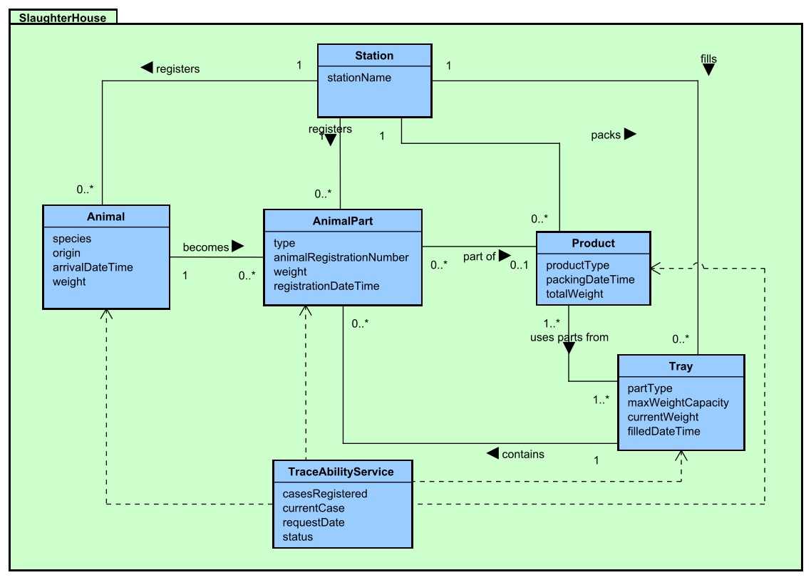
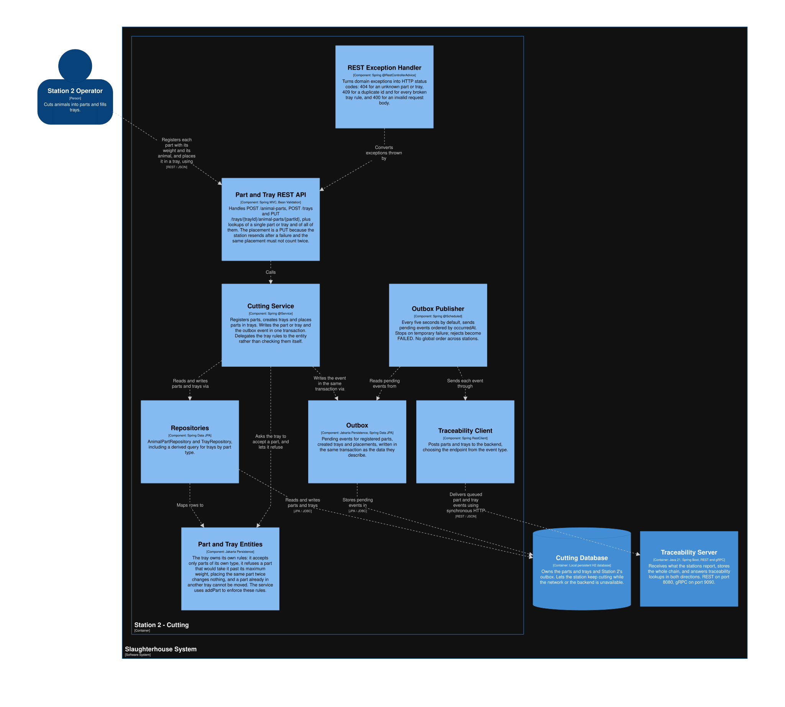
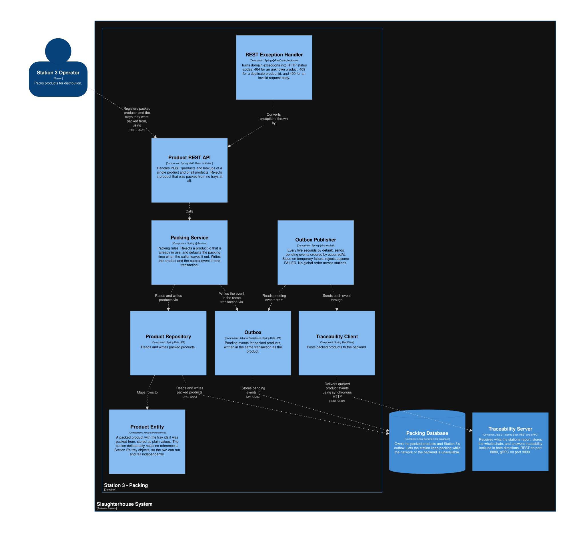

# DSY-SlaughterHouse

Studieprojekt i distribuerede systemer med registrering, opskæring, pakning og sporbarhed over gRPC.
Hver station har sin egen database og outbox, så den kan gemme lokalt under netværksnedbrud.

Åbn de afsnit, du vil arbejde med. Al dokumentation er samlet her.

<details>
<summary><strong>Kom i gang</strong></summary>


Kræver Java 21, Maven og PostgreSQL.

1. Opret databasen `slaughterhouse`, eller brug projektets `compose.yaml` og `.env.example` til Docker.
2. Kopiér `server/src/main/resources/application.properties.example` til `application.properties`, og angiv `DB_PASSWORD` som miljøvariabel. Tilpas eventuelt `DB_URL` og `DB_USERNAME`.
3. Byg fra projektets rodmappe:

   ```powershell
   mvn install -DskipTests
   ```

4. Start `Server`, `RegistrationServiceApplication`, `CuttingServiceApplication` og `PackingServiceApplication` fra IDE'en. Brug projektets rodmappe som arbejdsmappe, så stationernes H2-filer ligger under `data/`.


</details>

<details>
<summary><strong>Projektets formål</strong></summary>

Dette er et studieprojekt og projektet har dermed ikke til formål at bygge et produktionsklart slagterisystem, men at give den studerende (mig) praktisk erfaring med distribuerede systemer, som er et nyt fagområde dette semester.

Repository indeholder en simulering af et slagteri og er en del af kurset **'DSY - Distribuerede Systemer'**. Casen er et slagteri hvor levende dyr ankommer i den ene ende, og færdigpakkede produkter leveres i den anden ende. Undervejs passerer dyret tre stationer: registrering, opskæring i dele, og pakning af produkter.

Det centrale krav er **sporbarhed / tracking**. Hvis det senere viser sig at der er problemer med et slagtet dyr, skal alle produkter der kan indeholde dele fra dyret, kunne kaldes tilbage. Den funktion skal kunne tilgås udefra, og derfor er den eksponeret som en gRPC-service.

</details>

<details>
<summary><strong>Domænemodel</strong></summary>

Domænemodellen viser de centrale begreber i slagteriet og relationerne mellem dem.



Sporingskæden er en vigtig del af modellen:

- Et `Animal` bliver skåret op i flere `AnimalPart`, og hver del husker hvilket dyr den kom fra.
- En `AnimalPart` kan være uden bakke, indtil den lægges i én `Tray`. En bakke indeholder kun én type dele og har en maksimal vægtkapacitet.
- Et `Product` pakkes ud fra en eller flere `Tray`, og gemmer referencer tilbage til de bakker delene kom fra.

Et produkt peger på bakker, ikke på enkelte dele. Det matcher virkeligheden: når man pakker fra en bakke, ved man hvilke dyr der kan være i bakken, men ikke nødvendigvis hvilken del der er endt i hvilken pakke. Sporingen bliver derfor en bevidst overvurdering — den finder alle dyr der **kan** være i produktet.

</details>

<details>
<summary><strong>Arkitektur (C4-modellen)</strong></summary>

Arkitekturen er modelleret i **Structurizr** med C4-modellens tre første niveauer. Kilden er én tekstfil, `docs/architecture/workspace.dsl`, som alle diagrammerne genereres ud fra.

Diagrammerne er store. Klik på et diagram for at åbne det i fuld størrelse.

### C1 - System Context
Hvad bygger vi, hvem bruger det, hvad gør brugerne, og hvordan passer systemet ind i det eksisterende systemlandskab. Fokus er på **typerne af kommunikation** frem for på teknologi.

<a href="docs/diagrams/C1-SystemContext.svg" target="_blank" rel="noopener">
  
</a>

De blå figurer er systemets faktiske **brugere**: de tre stationsoperatører og en quality officer. De grå kasser er **eksterne systemer og parter** omkring systemet — de bruger ikke softwaren, men afgrænser processen.

- **Animal Supplier**, **Transport / Logistics** og **Customer / Supermarket** viser **fysisk vareflow**, ikke implementerede softwareintegrationer. De udveksler fysiske varer, og systemet må ikke gå i stå fordi en af dem er utilgængelig.
- **External Recall System** kommunikerer **direkte** over gRPC. Det er her sporbarhedsopslaget kaldes, og det er den del der er implementeret i dette projekt.

### C2 - Container View
Hvordan systemet er delt op i kørende enheder, og hvordan de taler sammen.

<a href="docs/diagrams/C2-Container.svg" target="_blank" rel="noopener">
  
</a>

Alle tre stationer, serveren og de fire databaser er implementeret.

Hver station har sin egen lokale database. Det er den del der opfylder casens krav om at *"work shouldn't stop at a station just because the network is down"*. Registreringen er tidsmæssigt afkoblet fra serveren: stationen skriver en hændelse i sin egen outbox i samme transaktion som dataene, og en baggrundsproces sender den videre med et synkront HTTP-kald, når serveren kan nås. Der bruges ingen message broker.

### C3 - Component View: Traceability Server
Serveren zoomet ind. Diagrammet afspejler den faktiske kode i `server`-modulet.

<a href="docs/diagrams/C3-Component-Traceability.svg" target="_blank" rel="noopener">
  
</a>

Serveren har to indgange. **Ind** kommer stationernes data over REST: `Ingestion Service` gemmer dem som upsert, så samme besked to gange giver samme resultat, og opretter pladsholdere for både dyr og bakker, hvis referencerne når frem før deres detaljer. Derfor behøver stationerne ingen aftalt rækkefølge.

**Ud** går sporingsopslagene over gRPC. Kontrakten bor i `traceability.proto`, og gRPC genererer en **client stub** og en **server stub** ud fra den. `gRPC API` implementerer server-stubben og oversætter domænefejl til statuskoder, mens `Traceability Service` bruger Spring Data-repositories og læsetransaktioner, men er uafhængig af gRPC.

### C3 - Component View: Station 1 (Registration)
Registration-servicen zoomet ind. Afspejler koden i `registration-service`-modulet.

<a href="docs/diagrams/C3-Component-Registration.svg" target="_blank" rel="noopener">
  
</a>

`Animal REST API` validerer input og holder HTTP ude af resten, `Animal Registration Service` har registreringsreglerne, og `REST Exception Handler` oversætter domænefejl til 404, 409 og 400.

Dyret og hændelsen skrives i **samme transaktion**, så en gemt registrering også har en gemt hændelse. Levering kan være forsinket; `FAILED`-hændelser kræver særskilt håndtering. `Outbox Publisher` tømmer køen hvert femte sekund; en 5xx betyder *prøv igen senere*, en 4xx betyder *aldrig gyldig* og hændelsen markeres `FAILED` så den ikke blokerer de øvrige. Alle tre stationer bruger samme mønster.

### C3 - Component View: Station 2 (Cutting)
Opskæringsservicen zoomet ind. Afspejler koden i `cutting-service`-modulet.

<a href="docs/diagrams/C3-Component-Cutting.svg" target="_blank" rel="noopener">
  
</a>

Bakken håndhæver **selv** sine regler: kun dele af sin egen type, ingen del der ville føre den over sin maksimale vægt, samme del to gange ændrer ingenting, og en del i en anden bakke kan ikke flyttes. Reglerne ligger i entiteten og ikke i servicen, når servicen bruger `Tray.addPart(...)`.

### C3 - Component View: Station 3 (Packing)
Pakkeservicen zoomet ind. Afspejler koden i `packing-service`-modulet.

<a href="docs/diagrams/C3-Component-Packing.svg" target="_blank" rel="noopener">
  
</a>

`Product` gemmer bakke-id'erne som **almindelige værdier**, ikke som referencer til Station 2's bakkeobjekter. Holdt den en reference til opskæringsstationens `Tray`-klasse, kunne de to moduler ikke længere bygges eller fejle uafhængigt af hinanden.

</details>

<details>
<summary><strong>Lokal infrastruktur</strong></summary>

De fire applikationer har hver sin database: serveren bruger PostgreSQL, og de tre stationer hver sin H2-fil under `DSY-SlaughterHouse/data/`. H2 er indlejret og kræver ingen opsætning.

Serverens egen `application.properties` er ikke i versionsstyring, fordi den indeholder databasekodeordet. Kopiér `server/src/main/resources/application.properties.example` til `application.properties` og udfyld `DB_PASSWORD` første gang.

PostgreSQL kører som en lokal installation på maskinen. Vil du i stedet køre den i Docker, skal den lokale tjeneste stoppes først, og `.env` oprettes ud fra `.env.example`:

```powershell
docker compose up -d
```

</details>

<details>
<summary><strong>Sådan afprøver du systemet</strong></summary>

### Traceability over gRPC

Sæt `app.seed-demo-data=true` i `server/src/main/resources/application.properties` første gang. Seederen opretter tre dyr (`1`, `2`, `3`), tre bakker, fire dele og to produkter: `PROD-LOIN-PACK` og `PROD-HALF-ANIMAL`.

Den kører **kun hvis `animal`-tabellen er tom**. Har databasen data fra tidligere, springer den over, og id'erne nedenfor findes ikke. Tjek hvad der faktisk ligger i den:

```powershell
psql -h localhost -U postgres -d slaughterhouse -c "select product_id from product" -c "select animal_id from animal"
```

Start `Server` fra IDE'en og kør konsolklienten med et produkt-id og et dyre-id:

```powershell
mvn -pl client exec:java "-Dexec.mainClass=com.example.Client" "-Dexec.args=PROD-LOIN-PACK 1"
```

Med demodata svarer den `Animals in product PROD-LOIN-PACK: [1, 2]` og `Products from animal 1: [PROD-HALF-ANIMAL, PROD-LOIN-PACK]` — begge sporingsretninger på én gang.

Et ukendt id giver `NOT_FOUND`. Et kendt dyr der endnu ikke er pakket giver `OK` med en tom liste. Servicen kan også kaldes fra Postman eller BloomRPC — gRPC reflection er slået til, så kontrakten kan hentes automatisk.

### Registrering over REST

Start `RegistrationServiceApplication` fra IDE'en.

```powershell
Invoke-RestMethod -Uri http://localhost:8081/animals -Method Post -ContentType "application/json" -Body '{"registrationNumber":9001,"weight":97.5,"origin":"Noerregaard"}'
```

Svaret er `201 Created` med en `Location`-header. Udelades `arrivalDateTime`, sætter servicen den til nu, så datoopslaget nedenfor skal bruge dagens dato:

```powershell
Invoke-RestMethod -Uri http://localhost:8081/animals/9001
Invoke-RestMethod -Uri "http://localhost:8081/animals?date=$(Get-Date -Format yyyy-MM-dd)"
Invoke-RestMethod -Uri "http://localhost:8081/animals?origin=Noerregaard"
```

Samme registreringsnummer to gange giver `409 Conflict`, et ukendt nummer giver `404 Not Found`, og en ugyldig body giver `400 Bad Request`.

### Hele kæden

Start alle fire applikationer og kør kæden igennem. Stationernes outbox forsøger normalt levering hvert femte sekund. Vent på synkroniseringen, før du kører gRPC-opslaget.

```powershell
Invoke-RestMethod -Uri http://localhost:8081/animals -Method Post -ContentType "application/json" -Body '{"registrationNumber":9001,"weight":97.5,"origin":"Noerregaard"}'
Invoke-RestMethod -Uri http://localhost:8082/trays -Method Post -ContentType "application/json" -Body '{"trayId":"TRAY-A","partType":"LOIN","maxWeight":50.0}'
Invoke-RestMethod -Uri http://localhost:8082/animal-parts -Method Post -ContentType "application/json" -Body '{"partId":"PART-A","type":"LOIN","weight":6.2,"animalRegistrationNumber":9001}'
Invoke-RestMethod -Uri http://localhost:8082/trays/TRAY-A/animal-parts/PART-A -Method Put
Invoke-RestMethod -Uri http://localhost:8083/products -Method Post -ContentType "application/json" -Body '{"productId":"PROD-A","productType":"LOIN_PACK","totalWeight":6.2,"trayIds":["TRAY-A"]}'

mvn -pl client exec:java "-Dexec.mainClass=com.example.Client" "-Dexec.args=PROD-A 9001"
```

Luk serveren og gentag de to første kald med **nye id’er**: stationerne svarer stadig `201`, og hændelserne bliver liggende i deres outbox indtil serveren er tilbage.

</details>

<details>
<summary><strong>Oversigt over systemets struktur</strong></summary>

```
DSY-SlaughterHouse/
├── pom.xml                 parent, styrer versioner for alle moduler
├── compose.yaml            PostgreSQL
├── proto/                  gRPC-kontrakten
├── server/                 Traceability: REST ind, gRPC ud, PostgreSQL
├── registration-service/   Station 1: registrering, egen H2-database
├── cutting-service/        Station 2: opskæring, egen H2-database
├── packing-service/        Station 3: pakning, egen H2-database
├── client/                 konsolklient til gRPC
└── docs/
    ├── analysis/           domænemodel
    ├── architecture/       Structurizr workspace
    └── diagrams/           eksporterede C4-diagrammer
```

`proto` indeholder kun gRPC-kontrakten. De fire øvrige er selvstændige Spring Boot-applikationer med hver sin database. Ingen af dem afhænger af hinanden.

</details>

<details>
<summary><strong>gRPC-API</strong></summary>

Kontrakten er defineret i `proto/src/main/proto/traceability.proto`:

```protobuf
service TraceabilityService {
  rpc GetAnimalsForProduct(GetAnimalsForProductRequest)
      returns (GetAnimalsForProductResponse);

  rpc GetProductsForAnimal(GetProductsForAnimalRequest)
      returns (GetProductsForAnimalResponse);

  rpc GetAnimalTrace(GetAnimalTraceRequest)
      returns (GetAnimalTraceResponse);

  rpc GetPartTrace(GetPartTraceRequest)
      returns (GetPartTraceResponse);
}
```

De to første giver en flad liste af id'er. `GetAnimalTrace` og `GetPartTrace` giver hele kæden med mellemleddene i behold: hvilke dele et dyr blev skåret i, hvilken bakke hver del havnede i, og hvilke produkter den bakke blev pakket til. `GetPartTrace` går den modsatte vej, fra én del tilbage til dyret.

Fejl oversættes til gRPC-statuskoder i stedet for at boble op som tekniske exceptions:

| Situation | Statuskode |
| --- | --- |
| Opslaget lykkedes | `OK` |
| Ukendt `product_id`, `registration_number` eller `part_id` | `NOT_FOUND` |
| Tomt `product_id` eller `part_id`, eller `registration_number` der ikke er positivt | `INVALID_ARGUMENT` |
| Uventet fejl, f.eks. databasen er nede | `INTERNAL` |

Et dyr der findes, men endnu ikke er pakket, er ikke en fejl. Det giver `OK` med en tom liste.

Sporingen fra bakke til produkt er en bevidst overvurdering. Et produkt ved hvilke bakker det er pakket fra, men ikke hvilken enkelt del der endte i hvilken pakke, så `product_ids` på en del betyder *may contain* og ikke *does contain*. Protobuf har ingen `null`, så en del der endnu ikke er lagt i en bakke, får et tomt `tray_id`.

</details>

<details>
<summary><strong>REST-API</strong></summary>

De tre stationer ligger på port 8081, 8082 og 8083.

**Station 1 — registrering (8081)**

| Metode og sti | Betydning | Svar |
| --- | --- | --- |
| `POST /animals` | Registrér et dyr | `201` med `Location` |
| `GET /animals/{registrationNumber}` | Ét bestemt dyr | `200` eller `404` |
| `GET /animals?date=2026-10-20` | Alle dyr ankommet den dato | `200` |
| `GET /animals?origin=Noerregaard` | Alle dyr fra den gård | `200` |
| `GET /animals` | Alle dyr | `200` |

**Station 2 — opskæring (8082)**

| Metode og sti | Betydning | Svar |
| --- | --- | --- |
| `POST /animal-parts` | Registrér en del | `201` med `Location` |
| `POST /trays` | Opret en bakke | `201` med `Location` |
| `PUT /trays/{trayId}/animal-parts/{partId}` | Læg en del i en bakke | `200`, `404` eller `409` |
| `GET /animal-parts`, `GET /animal-parts/{partId}` | Alle dele, eller én | `200` eller `404` |
| `GET /trays`, `GET /trays/{trayId}` | Alle bakker, eller én | `200` eller `404` |

Placeringen er en `PUT` fordi den skal kunne gentages: stationen gensender efter en netværksfejl, og den samme placering må ikke tælle to gange.

**Station 3 — pakning (8083)**

| Metode og sti | Betydning | Svar |
| --- | --- | --- |
| `POST /products` | Pak et produkt fra en eller flere bakker | `201` med `Location` |
| `GET /products`, `GET /products/{productId}` | Alle produkter, eller ét | `200` eller `404` |

Serveren har de samme fire stier på port 8080, men de bruges kun af stationernes outbox og ikke af mennesker.

De to filtre kan ikke kombineres — `?date=…&origin=…` svarer `400` i stedet for at ignorere det ene i stilhed.

Fejl følger samme princip som på gRPC-siden — domænefejl bliver til statuskoder, ikke stacktraces:

| Situation | Statuskode |
| --- | --- |
| Ukendt registreringsnummer | `404 Not Found` |
| Registreringsnummer allerede i brug | `409 Conflict` |
| Manglende eller ugyldigt felt i body | `400 Bad Request` |
| `date` og `origin` i samme kald | `400 Bad Request` |

Datoopslaget bruger den konfigurerede `app.slaughterhouse.timezone` og et halvåbent interval `[dagen 00:00, dagen efter 00:00)`, så et dyr der ankom 23:59 tæller med på sin egen dag. Opslag på gård er ikke versalfølsomt.

</details>

<details>
<summary><strong>Persistens</strong></summary>

Ingen af de fire applikationer deler database eller skema. Serveren ejer `animal`, `animal_part`, `tray` og `product` i PostgreSQL. Hver station ejer sine egne tabeller plus sin egen `outbox_entry` i sin egen H2-fil. De kan startes, stoppes og udvikles uafhængigt af hinanden.

Opslagene bruger afledte queries, fx `findByTrayIn(...)` og `findByOriginIgnoreCase(...)`, så filtreringen sker i databasen frem for i hukommelsen.

</details>

<details>
<summary><strong>Test</strong></summary>

Projektets tests er delt op efter lag: forretningslogikken isoleret med mocks, servicerne mod en rigtig database, og yderlagene hver for sig — gRPC in-process og REST med MockMvc. Alle fire applikationer har desuden en `contextLoads`-test, der beviser at de overhovedet starter.

Bakkens regler er testet som ren forretningslogik uden Spring, og hver stations outbox er testet på de tre udfald: sendt, midlertidigt utilgængelig, permanent afvist.

Serverens tests kører mod PostgreSQL og ikke mod en database i hukommelsen, så de afledte queries bliver oversat til samme SQL-dialekt som i produktionen. Stationerne tester mod H2 i hukommelsen, som er den samme motor de kører på i drift. Serverens tests kræver en lokal PostgreSQL, og at databasen er oprettet én gang:

```sql
CREATE ROLE slaughterhouse_test WITH LOGIN PASSWORD 'slaughterhouse_test';
CREATE DATABASE slaughterhouse_test OWNER slaughterhouse_test;
```

Brugeren er bevidst en engangsbruger uden adgang til andet end testdatabasen, så dens kodeord kan stå i `src/test/resources/application.properties`. Skemaet oprettes og droppes af Hibernate ved hver kørsel.

Testene er kommenteret på dansk, da de også fungerer som mine egne noter til hvad der testes og hvorfor.

</details>

<details>
<summary><strong>Teknologier</strong></summary>

- Java 21
- Maven multi-modul projekt
- gRPC og Protocol Buffers
- Spring Boot og Spring Data JPA
- PostgreSQL og H2
- JUnit 5, Mockito og AssertJ
- Astah til domænemodel
- Structurizr (DSL) til C4-diagrammerne

</details>

<details>
<summary><strong>Status</strong></summary>

Implementeret:

- Domænemodel
- C1, C2 og fire C3-diagrammer modelleret i Structurizr
- Alle tre stationer som selvstændige REST-services med hver sin database
- Synkronisering op til serveren via transactional outbox, med tidsordnet behandling pr. station og status `FAILED` ved permanent afvisning
- Serveren modtager stationernes data idempotent som upsert
- Håndhævelse af bakkens deltype og maksimale vægt
- gRPC-service med begge sporingsopslag og fuld sporing af et dyr eller en del, plus reflection til Postman og BloomRPC
- Persistens i PostgreSQL og H2 via Spring Data JPA
- Eksplicit fejlhåndtering: 201, 400, 404, 409 og 503 på REST, og NOT_FOUND, INVALID_ARGUMENT og INTERNAL på gRPC
- Tests fordelt på lagene
- Konsolklient og demodata-seeder til afprøvning

Ikke implementeret:

- Grafisk brugerflade
- Autentificering og autorisation
- Rettelse og sletning af data der allerede er registreret

</details>


<details>
<summary><strong>Diagramgennemgang og kendte afvigelser — 27. oktober 2026</strong></summary>

Domænemodellen er rettet til serverens aktuelle entiteter. `Product` refererer til `Tray`, ikke direkte til `AnimalPart`. En del har ét dyr og kan endnu være uden bakke. En tom bakke kan være uden produkter; et produkt oprettes fra mindst én bakke i stationens API.

C4-kilden, JSON-modellen og SVG-teksterne er rettet: konfigureret tidszone, pladsholdere for både dyr og bakker, faktisk brug af JPA samt HTTP-levering fra outbox. Fysisk vareflow er adskilt fra softwarekald. `FAILED` betyder ikke automatisk genlevering, og køerne giver ingen global rækkefølge på tværs af stationer.

**Forhold i implementeringen, der bør følges op på:**

- `CuttingService.placeInTray` øger vægten lokalt, men opretter kun en `PART_PLACED_IN_TRAY`-hændelse. Serveren opdaterer kun `Tray.currentWeight` i `receiveTray`, så dens vægt kan forblive 0. Send også en opdateret bakke eller beregn vægten på serveren.
- Serveren accepterer pladsholdere. Under synkronisering kan sporingsopslag derfor returnere ufuldstændige resultater som `OK`; der findes ingen markering af, om hele kæden er modtaget.
- `FAILED`-hændelser springes over. Der findes endnu ingen brugerflade til at se, rette eller gensende dem.
- Outbox sorterer kun efter `occurredAt`. Samme tidsstempel har ingen ekstra sorteringsnøgle; streng rækkefølge er derfor ikke garanteret ved lighed.
- Registreringsnummer vælges manuelt. Automatisk nummer, dyretypekatalog, login, redigering og sletning fra GUI-planen er fremtidigt arbejde. `species` og `slaughterDateTime` findes på serverens `Animal`, men udfyldes ikke af registreringsflowet.

Den tidligere Astah-fil er en konceptuel original og er ikke omskrevet. Den opdaterede domænemodel har en redigerbar [PlantUML-kilde](docs/architecture/domain-model.puml). C4-SVG’ernes eksisterende layout er bevaret; beskrivelserne er opdateret på stedet.

Gennemgangen er baseret på kode og diagrammer; den er ikke en ny kørsel af systemets integrationstests.

</details>
