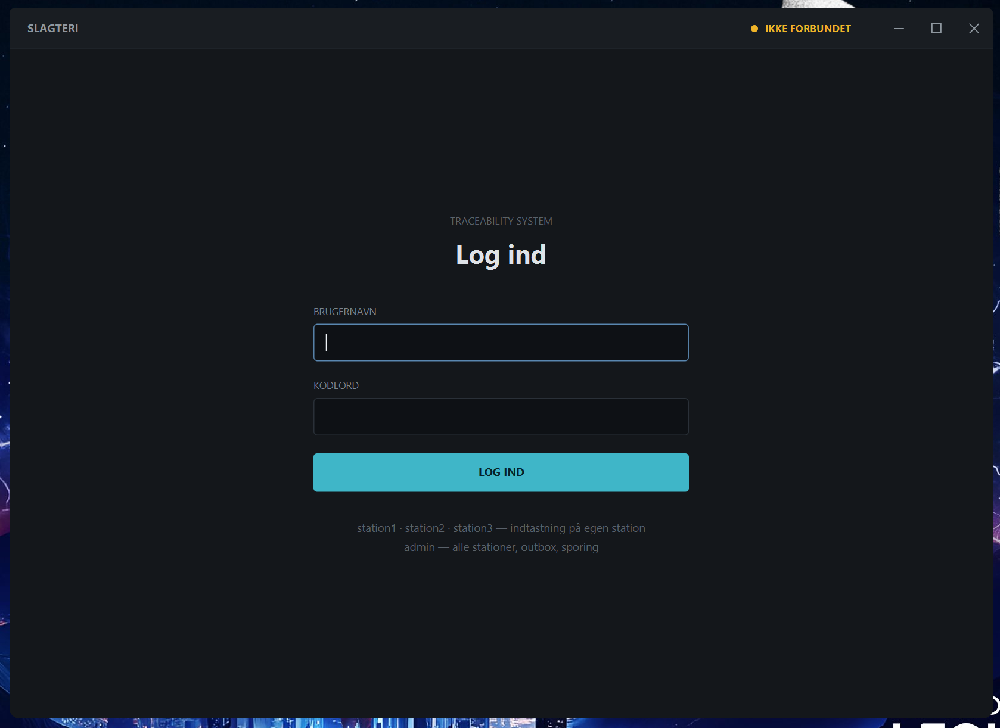
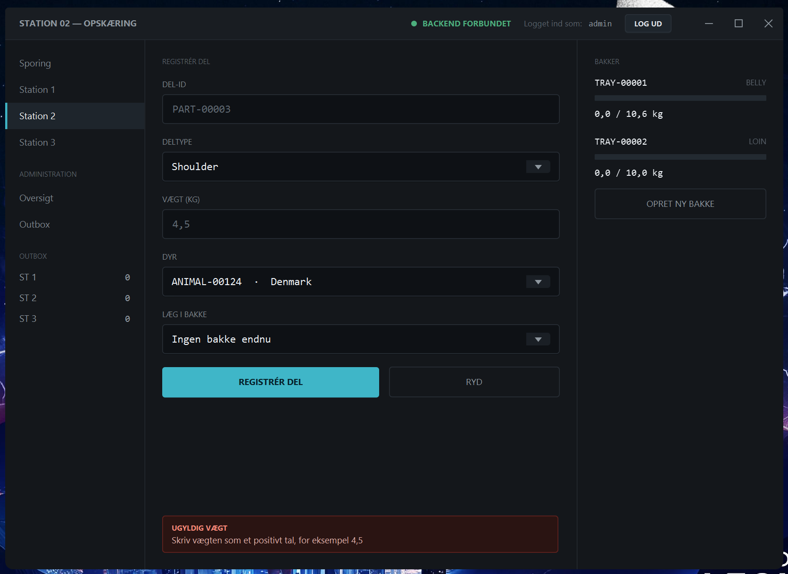
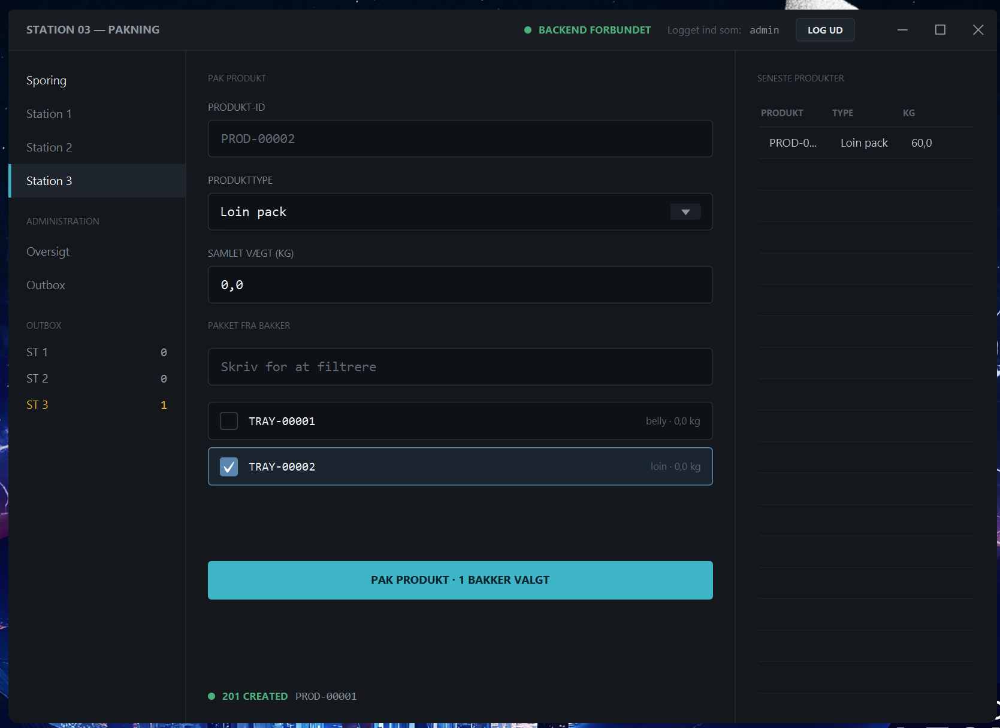
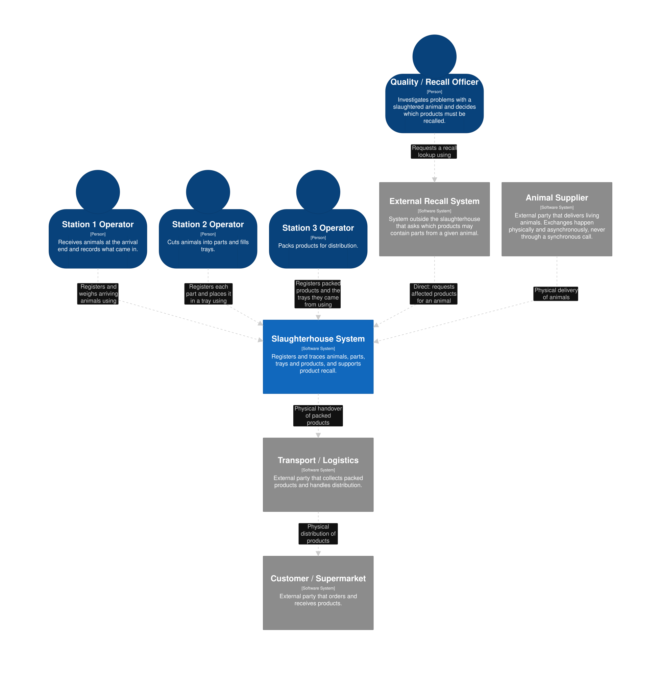
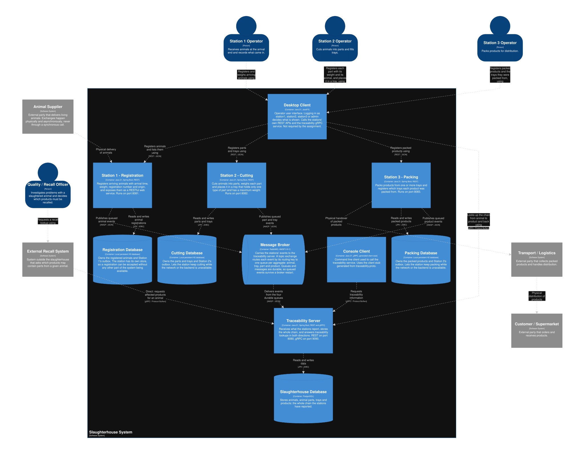

# DSY-SlaughterHouse

Studieprojekt i **Distribuerede Systemer** med tre stationer: registrering af dyr, opskæring og pakning. Stationerne gemmer i hver sin H2-database og sender hændelser via RabbitMQ til en central server med PostgreSQL. JavaFX-klienten bruger REST til stationerne og gRPC til sporing.

Klik på et billede for at åbne det i fuld størrelse.

<table>
  <tr><th>Login</th><th>Station 1</th><th>Station 2</th><th>Station 3</th><th>Oversigt</th></tr>
  <tr>
    <td></td>
    <td></td>
    <td></td>
    <td></td>
    <td></td>
  </tr>
</table>

<strong>Funktioner</strong>

- **Station 1:** registrerer vægt og oprindelse; tidspunkt sættes af servicen, mens GUI’en foreslår registreringsnummer.
- **Station 2:** registrerer dele og bakker. Bakker har deltype og maksimal vægt; en placeret del kan ikke flyttes til en anden bakke. GUI’en viser fyldningsgrad.
- **Station 3:** pakker produkter fra valgte bakker. GUI’en foreslår samlet vægt, som kan rettes før registrering.
- **Sporing:** gRPC-opslag på produkt, dyr og del. Produkter peger på bakker, så et opslag viser **mulige** kildedyr.
- **Admin:** oversigt over registreringer samt stationernes ventende outbox-hændelser og deres payload.
- **Login:** fire faste demobrugere i JavaFX-klienten. Stationsbrugere ser egen station og sporing; admin ser alle visninger.

<strong>Kom i gang</strong>

- Kræver **Java 21, Maven, PostgreSQL og RabbitMQ**.
- PostgreSQL: opret databasen `slaughterhouse`, eller kopiér `.env.example` til `.env`, udfyld `POSTGRES_PASSWORD`, og kør `docker compose up -d`. Compose starter kun PostgreSQL.
- RabbitMQ: start den separat. Serveren opretter exchange og køer ved opstart. Standardadresse er `localhost:5672`.
- Server: kopiér `server/src/main/resources/application.properties.example` til `application.properties`, og sæt `DB_PASSWORD` til PostgreSQL-adgangskoden.
- Byg fra projektets rodmappe: `mvn install -DskipTests`.
- Start `Server`, `RegistrationServiceApplication`, `CuttingServiceApplication` og `PackingServiceApplication` fra projektets rodmappe i IDE’en. Det placerer stationernes H2-filer under `data/`.
- Start GUI’en: `mvn -pl desktop-client javafx:run`.

| Bruger | Adgangskode | Adgang |
| --- | --- | --- |
| `station1` | `station1` | Registrering og sporing |
| `station2` | `station2` | Opskæring og sporing |
| `station3` | `station3` | Pakning og sporing |
| `admin` | `admin` | Alle visninger |

Login beskytter kun GUI’en; REST og gRPC har ingen backend-autentificering. Klientens adresser kan ændres med `REGISTRATION_URL`, `CUTTING_URL`, `PACKING_URL`, `BACKEND_BASE_URL`, `TRACE_HOST` og `GRPC_PORT`.

<strong>Moduler og dataflow</strong>

| Modul | Ansvar | Port |
| --- | --- | --- |
| `registration-service` | Dyr, H2 og outbox | 8081 |
| `cutting-service` | Dele, bakker, H2 og outbox | 8082 |
| `packing-service` | Produkter, H2 og outbox | 8083 |
| `server` | Modtagelse og sporing i PostgreSQL | REST 8080, gRPC 9090 |
| `desktop-client` | JavaFX, REST og gRPC | — |
| `proto` / `client` | gRPC-kontrakt / konsolklient | — |

- Stationsdata og en outbox-hændelse gemmes i samme transaktion. Publisheren prøver hvert femte sekund og sender højst 100 ventende hændelser pr. kørsel.
- RabbitMQ modtager hændelser i `slaughterhouse.events`; serveren lytter på fire køer. Serverens REST-modtagelse findes også, men stationerne bruger RabbitMQ.
- Outbox-hændelsen slettes efter **brokerens** kvittering. Det bekræfter levering til RabbitMQ, ikke at serveren har gemt hændelsen. Afviste beskeder kan ende i `traceability.dead-letter`.
- Serveren kan oprette midlertidige dyr og bakker, når hændelser ankommer i en anden rækkefølge. Der er ingen samlet rækkefølge eller deduplikering af gamle hændelser på serveren.

<strong>API og afprøvning</strong>

- Station 1: `POST/GET /animals`, `GET /animals/{registrationNumber}`; listen kan filtreres på `date` **eller** `origin`.
- Station 2: `POST/GET /animal-parts`, `POST/GET /trays`, opslag på id og `PUT /trays/{trayId}/animal-parts/{partId}`.
- Station 3: `POST/GET /products` og `GET /products/{productId}`.
- Alle stationer: `GET /outbox`. Centralserveren: `POST /animals`, `/animal-parts`, `/trays`, `/products` samt `GET /actuator/health`.
- gRPC-metoderne står i [`traceability.proto`](proto/src/main/proto/traceability.proto): `GetAnimalsForProduct`, `GetProductsForAnimal`, `GetAnimalTrace` og `GetPartTrace`.
- Prøv hele kæden: registrér dyr → opret bakke og del → placér delen → pak produkt → slå produkt eller dyr op under **Sporing**. Stop RabbitMQ for at se ventende hændelser i outbox; start den igen for at prøve levering.

<strong>Domænemodel og C4</strong>

Sporingskæden er `Product → Tray ← AnimalPart → Animal`. Diagrammerne viser arkitekturen; enkelte detaljer kan være ældre end koden. [C4-kilde](docs/architecture/workspace.dsl).

| Domænemodel | C1 | C2 |
| --- | --- | --- |
|  |  |  |

| C3 server | C3 registrering | C3 opskæring | C3 pakning |
| --- | --- | --- | --- |
|  |  |  |  |

[Tegnforklaring](docs/diagrams/C4-Key.svg).

<strong>Test og kendte begrænsninger</strong>

- Kør `mvn test` fra rodmappen. Serverens JPA-tests kræver PostgreSQL: `CREATE ROLE slaughterhouse_test WITH LOGIN PASSWORD 'slaughterhouse_test';` og `CREATE DATABASE slaughterhouse_test OWNER slaughterhouse_test;`. Stationernes JPA-tests bruger H2.
- GUI’en foreslår ID’er ud fra eksisterende registreringer. Samtidige klienter kan derfor vælge samme ID.
- Stationernes API’er kan registrere uden centralserveren eller RabbitMQ. GUI’en på station 2 henter dyr fra station 1; station 3 henter bakker fra station 2. De valg kræver forbindelse mellem stationerne.
- Hvis registrering af en del lykkes, men bakkeplaceringen fejler, bevares delen uden bakke. GUI’en har endnu ingen særskilt handling til at placere den bagefter.
- Admin ser stationernes outbox, men ikke RabbitMQ’s dead-letter-kø. Tom outbox og grøn serverstatus beviser derfor ikke komplet sporing.
- Adminoversigten er skrivebeskyttet. Redigering, sletning og administration af dyretyper er endnu ikke implementeret.

